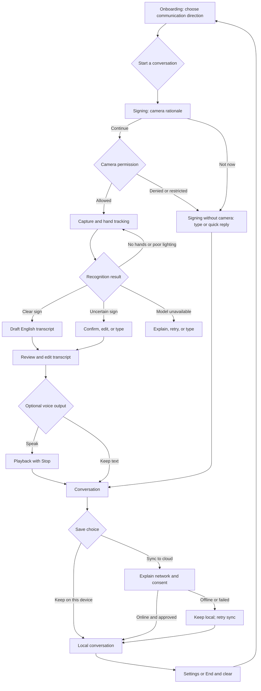

# Accessible conversation flow

Low-fidelity UX handoff for issue [#2](https://github.com/argus1/SignifyGesture/issues/2).
These wireframes define the intended interaction; they are not a claim that every
state is implemented in the prototype. Current implementation notes are called
out below so design and engineering can distinguish working behavior from gaps.

## Flow map



The two speech directions are deliberately separate:

1. **Incoming spoken English → live text captions.** This uses microphone and
   speech-recognition permission. If unavailable, keep the conversation usable
   with typed input and quick replies; do not imply that captions are listening.
2. **Reviewed ASL transcript → optional spoken playback.** This is an explicit
   user action after review. TTS playback itself does not request microphone
   permission. Show a distinct Speaking state and a Stop control; never present
   playback as incoming captions.

## Wireframes

### 1. Onboarding and direction choice

```text
┌──────────────────────────────────┐
│ Signify                    Skip  │
│ Talk face to face                │
│                                  │
│  [Hand] You sign → English text  │
│  [Mic ] They speak → live text   │
│                                  │
│  Optional: speak reviewed text   │
│  out loud after you approve it.  │
│                                  │
│        [ Start conversation ]    │
│          [ Settings ]            │
└──────────────────────────────────┘
```

The labels and icons communicate the source and result without relying on
color. Explain that camera and microphone access are requested only when the
corresponding mode starts.

### 2. Camera rationale and permission outcomes

```text
┌──────────────────────────────────┐
│ Camera access                    │
│ Use the front camera for hand    │
│ tracking. Video is not saved or  │
│ sent to the web UI.              │
│                                  │
│ [Continue]             [Not now] │
└──────────────────────────────────┘
```

- **Denied:** “Camera access is off. Open Settings to allow it, or continue
  without camera using Type or a quick reply.” Actions: **Open Settings**,
  **Continue without camera**.
- **Restricted/unavailable:** explain the specific reason and provide **Type
  instead** and **Back**.
- Do not repeatedly prompt after denial. Preserve typed/quick-reply
  communication without camera.

The native shell currently supplies camera rationale, denial, restricted, and
unavailable prompts (`NativeShellView.swift`, `NativeBridgeCoordinator.swift`).
Microphone and speech-recognition authorization use the same pattern: the
rationale alert appears only when Speech mode first starts listening, denial
offers **Open Settings** or **Type instead**, and the web status reads "Live
captions are unavailable. Tap Type to reply".

### 3. Capture, recognition, and uncertainty

```text
┌──────────────────────────────────┐
│ [Back]             [Agent] [Voice]│
│                                  │
│      [Camera / hand preview]     │
│                                  │
│  Status: Listening for signs     │
│  Icon + text; never color alone   │
│                                  │
│  ┌────────────────────────────┐  │
│  │ You signed: “I want …”     │  │
│  │ [Confirm] [Edit] [Type]    │  │
│  └────────────────────────────┘  │
│ [Signing]      [Type]   [Speech] │
│ [Stop camera]                    │
└──────────────────────────────────┘
```

State copy and recovery:

| State | Visible text and icon | Primary recovery |
|---|---|---|
| Ready | “Listening for signs” + hand/camera icon | Sign or choose Type |
| Tracking lost/no hands | “Hands not in view” + hand-outline icon | “Move hands into view” |
| Poor lighting | “Lighting is too low” + light icon | “Move to brighter light” or Type |
| Checking uncertain sign | “Checking this sign” + progress icon | Wait, then Confirm/Edit/Type |
| No recognition result | “No sign recognized” + retry icon | “Try again” or Type |
| Model unavailable | “Sign recognition unavailable” + warning icon | Retry when available or Type |
| Camera off | “Camera is off” + camera-off icon | Start camera or Type |

Keep the transcript visible and editable. A recognized but uncertain sign must
not silently become final text: pause for **Confirm**, **Edit**, or **Type**.
The existing repair card and typed-message path are useful starting points.
No-hands and poor-lighting detection need native signals before those states can
be shown reliably.

### 4. Incoming speech captions

```text
┌──────────────────────────────────┐
│ [Back]       Speech captions     │
│                                  │
│   [Microphone icon]              │
│   Listening to spoken English    │
│                                  │
│  ┌────────────────────────────┐  │
│  │ “Could I get a coffee?”     │  │
│  │ Live caption                 │  │
│  └────────────────────────────┘  │
│                                  │
│ [Pause captions] [Type reply]    │
│ [Stop listening]                │
└──────────────────────────────────┘
```

Ask for microphone and speech-recognition access only on entry to this mode,
with a plain-language rationale first. If either permission is denied or
unavailable, state “Live captions are unavailable” and offer **Type reply**,
**Quick reply**, and **Back**. A partial transcript is announced as it changes;
final text is announced once as a completed caption.

### 5. Transcript review and optional playback

```text
┌──────────────────────────────────┐
│ Review your message              │
│                                  │
│  ┌────────────────────────────┐  │
│  │ [Editable transcript]      │  │
│  └────────────────────────────┘  │
│  [Edit]              [Confirm]   │
│                                  │
│  Optional voice output           │
│  [Speak reviewed transcript]     │
│  [Stop speaking] (while playing) │
│  Status: Ready / Speaking / Done │
│                                  │
│  [Continue with text]            │
└──────────────────────────────────┘
```

Speak only the confirmed text. Keep the text visible during playback and expose
**Stop speaking** as an immediate action. If playback fails, announce
“Voice playback failed; your text is still available” and keep **Continue with
text** available. TTS is optional; the written transcript remains the source
of truth.

### 6. Local/cloud choice and sync failure

```text
┌──────────────────────────────────┐
│ Where should this conversation   │
│ be saved?                        │
│                                  │
│ (•) On this device               │
│     Available offline            │
│ ( ) Sync to cloud                │
│     Requires network and consent │
│                                  │
│ [Keep on this device] [Save]     │
│                                  │
│ Offline/error:                   │
│ “Saved on this device. Cloud     │
│ sync can retry when online.”     │
│ [Retry sync] [Keep local]        │
└──────────────────────────────────┘
```

Default to **On this device**. Explain what syncing stores before asking for
consent. A network failure must not discard the local transcript or appear as a
successful cloud save; offer retry and keep-local actions. The current AWS sync
service is a stub, not production cloud storage.

### 7. Settings and end/clear

```text
┌──────────────────────────────────┐
│ Settings                         │
│ Text size                 [A—A+] │
│ High contrast             [ On ] │
│ Spoken playback           [ On ] │
│ Camera permission     [Manage]  │
│ Microphone permission  [Manage]  │
│ Save location       [Device v]   │
│                                  │
│ [End conversation]               │
└──────────────────────────────────┘
```

Ending a conversation stops camera capture, microphone listening, and any TTS
playback before leaving. If the user selects **Clear conversation**, confirm
with the impact (“This removes the transcript from this device”) and offer
**Keep conversation** / **Clear conversation**. Keep **End conversation** and
**Clear conversation** distinct; stopping must always be available without
deleting text.

## Accessibility handoff

- **VoiceOver order:** screen title and mode → permission/status explanation →
  live transcript → uncertainty/edit actions → mode controls → stop/end action.
  Keep decorative camera art and waveform bars hidden from accessibility.
- Use concise, explicit accessible names (for example, “Stop speaking”,
  “Stop listening”, “Stop camera”, “Edit recognized text”). Announce permission
  results, recognition uncertainty, errors, and final captions as status
  updates; do not repeatedly announce every partial word.
- Every state has a text label and a meaningful icon; color is supplementary.
  Do not encode readiness, errors, or speaker direction using color alone.
- Support Dynamic Type without truncating transcript or primary actions. Let
  content scroll when enlarged; keep dialogs and controls within safe areas.
- Make interactive targets at least 44 × 44 pt, maintain clear focus indicators,
  and verify text/background contrast at WCAG AA (4.5:1 normal text, 3:1 large
  text and essential non-text controls).
- Honor Reduce Motion. Provide stable text alternatives for animation and avoid
  using animation as the only indication of listening or recognition.
- Keep “You sign” and “They speak” visible in mode labels; use separate
  microphone/listening and playback/speaking labels and controls.

## Prototype coverage and validation

Already present: camera-mode rationale/denial/restricted/unavailable prompts;
native camera stop; recognition status messages; sign repair and typing; live
caption updates; optional voice toggle; and end-to-recap navigation. Relevant
implementation: `src/routes/home.tsx`, `src/routes/sign.tsx`,
`src/lib/signify-store.tsx`, `iOSApp/Sources/App/NativeShellView.swift`, and
`iOSApp/Sources/NativeBridge/NativeBridgeCoordinator.swift`.

Incoming speech captions and TTS are implemented natively
(`iOSApp/Sources/Speech/`): `SpeechAnalyzer`/`SpeechTranscriber` on iOS 26+
with an `SFSpeechRecognizer` fallback (on-device when supported), partial
captions that finalize after a ~1.4 s pause, and `AVSpeechSynthesizer` for
spoken output. Non-audio cues for Deaf/HoH users: the Speech-mode waveform
follows real mic loudness (and pulses per spoken word while the app speaks),
the spoken word is highlighted in the caption, a haptic plays when TTS starts,
finishes, or is stopped, and an edge flash marks start/end where there is no
Taptic Engine (iPad). A **Stop speaking** control is shown whenever TTS is
playing. The mic is muted while TTS plays so the app never captions itself.

Still design/engineering gaps: onboarding and settings screens; explicit
transcript review/edit before playback; clear confirmation; reliable no-hands/poor-lighting state signals; production local
storage and cloud consent/retry; and end-to-end status announcements.

**Accessibility review: unvalidated.** No Deaf/HoH or accessibility-informed
reviewer was available for this handoff. Arrange review before treating this
flow as validated, and record feedback and resulting changes here.
