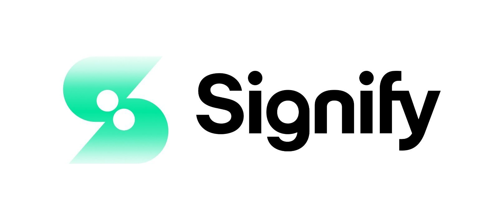
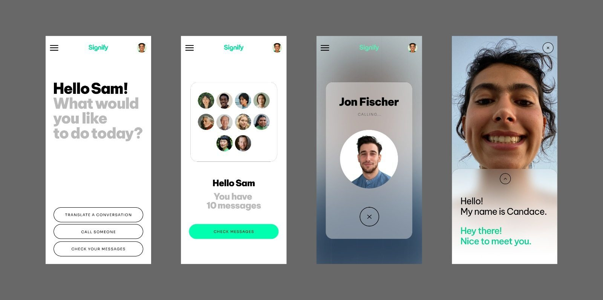

# SignifyGesture
Mobile App for Sign Language Gesture Recognition





SignifyGesture combines a React web frontend with a native iOS shell. The iOS
app presents the frontend in a `WKWebView` and provides native camera, hand-pose,
and speech capabilities through a JavaScript bridge.

Please merge freely to `dev`, but open a PR for `main`, which will be merged
after team approval during daily scrum.

## Native iOS app

See the [native iOS runbook](Docs/NATIVE_IOS_RUNBOOK.md) for setup and
simulator builds, and the [beginner Xcode device guide](Docs/NATIVE_IOS_XCODE_DEVICE_GUIDE.md)
for step-by-step instructions to build, install, and test on an iPhone or iPad.

## Web frontend

Install [Bun](https://bun.sh/) and run the frontend from the repository root:

```bash
bun install
bun run dev
```

Run frontend tests with `bun test` and create a production build with
`bun run build`.

## CI and agentic workflows

See the [agentic workflows development plan](Docs/agentic-workflows.md) for the
six bounded agents, acceptance checklists, deterministic CI, and activation
requirements. Agents are disabled until explicitly enabled; code-writing agents
also require a protected approval environment and only create draft PRs.

## Repeatable evaluation fixtures

From the repository root, run the synthetic reporting check without a model,
camera, network, or raw recordings (Node.js 22.6+):

```sh
npm run evaluate:asl -- fixtures/asl-evaluation/validation.json fixtures/asl-evaluation/test.json 0.7
```

With Bun, use `bun run scripts/evaluate-asl.ts` with the same three arguments.
Run its regression tests with `npm test -- src/test/asl-evaluation.test.ts`
(requires Node.js 22.6+ and installed development dependencies).

These are **invented prediction records**, not model results or measurements of
real signers/devices. See the [fixture protocol, expected results, consent and
deletion rules, and limitations](Docs/ASL_translation_hackathon_plan.md#p07-fixture-protocol)
before collecting or evaluating human samples.

## Help assistant status

The Help button on the main tab screens and conversation screen opens searchable,
bundled instructions. It reads only the current screen and coarse camera,
tracking, recognition and speech status; it does not read captions or send
questions to a model. Closing it returns to the existing screen and conversation.
The browser camera is a sample, not a live feed.

AI help is an integration stub, not an enabled provider. The intended policy is
cloud primary with local AFM validation on a ready device, otherwise cloud
validation; on offline or unstable connections a ready AFM would be primary
without validation. A later cloud review must be explicit, not silently queued.
Devices such as iPhone 15 Pro and iPads with M1 or later are candidates, not a
readiness guarantee: OS, device configuration and model availability must be
checked at runtime. The policy does not infer unavailable from unknown. Neither
AFM readiness nor unstable connectivity is currently wired.
On an offline device without local inference, AI help reports that it is offline.
The neighboring HealthCoacher project informed the future provider contract:
bounded requests and explicit provider failures belong behind the service, not
in the web view. Its direct provider clients and embedded-key approach are not
used here; OpenAI, Anthropic, and OpenRouter remain configuration placeholders.

Offline launch requires the bundled-frontend work in #20; instructions can only
be used when the frontend is already available. No provider credentials are
needed for this stub. Before enabling cloud help, use Lovable's AI gateway
through an authenticated HTTPS backend with separate informed consent, provider
and retention disclosures, opt-out, cancellation, limits, and explicit errors.
Do not embed provider keys in the app or browser. No real model, device,
VoiceOver, offline-launch, latency, or cloud verification claim is made here.
